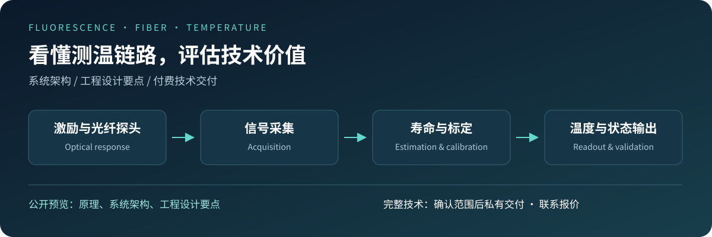

# Fluorescent Optical Fiber Temperature Sensing — Technical Overview

An overview of an embedded fluorescence-lifetime temperature sensing project built around a **single-channel GD32F150G8U6 platform**.

[中文首页](README.md) · [Contact / request a quote](https://github.com/valiidea/Fluorescent-Optical-Fiber-Temperature-Sensor-Preview/issues/new?template=consultation.yml)

## What the project covers

The engineering scope includes excitation control, ADC/DMA acquisition, lifetime estimation, filtering and state management, calibration, temperature conversion, Modbus RTU communication, and host tools.

After excitation stops, the probe's fluorescence decays. A lifetime characteristic is extracted from that response and mapped to temperature through calibration. Signal quality, background, probe characteristics and acquisition conditions remain relevant to the resulting measurement.

| Area | Engineering concern |
|---|---|
| Optical excitation and acquisition | Signal strength, saturation, background and timing |
| Lifetime estimation | Usable signal characteristics and invalid-input handling |
| Filtering and state | Output variation, response delay, startup and recovery |
| Calibration | Probe applicability, operating range and parameter versions |
| Communication | Result freshness, status interpretation and integration |
| Build and verification | Tool versions, dependencies and validation boundaries |

## Public material

This repository provides conceptual architecture diagrams, module responsibilities, engineering tradeoffs, integration questions and validation methods. It publishes **no measured serial data, acquisition logs, measured plots or statistical reports**. Diagrams describe concepts rather than exact firmware timing or state machines.

Production sampling strategies, lifetime estimation, calibration parameters, firmware binaries and complete source remain private.

## Reading guide

- [System architecture](docs/system-overview.md)
- [Engineering considerations](docs/engineering-notes.md)
- [Integration assessment](docs/integration-guide.md)
- [Measurement and acceptance guide](docs/measurement-guide.md)
- [Preview boundaries](docs/preview-boundary.md)
- [Commercial delivery](docs/purchase.md)

The detailed guides are currently in Chinese. The preview is intended to help engineers assess technical fit before discussing a delivery package.

## Commercial delivery

**Contact for a quote.** Delivery scope, target hardware, permitted use, validation boundaries and support are agreed before payment. Agreed materials are then delivered privately. Complete hardware designs, probe material recipes and motherboard firmware are not included by default. This preview does not claim full-range accuracy, production certification or compatibility with arbitrary hardware.

Open a consultation Issue with public information only. Confidential requirements and payment details should move to a mutually agreed private channel. See [LICENSE](LICENSE) for the limited non-commercial evaluation permission; commercial use and redistribution require a separate agreement.
